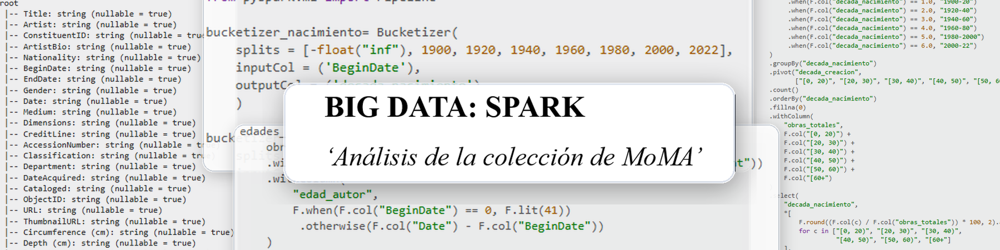

## Proyecto

_ES_:
Estudio mendiante consultas de Spark de la colección de obras de arte del Museo de Arte Moderno de Nuevo York (MoMA).

_EN_:
Analysis of the Museum of Modern Art (MoMA) collection of artworks using Spark queries.

## Descipción de archivos

| Archivo | Descripción |
|---|---|
| MoMA_Artworks.parquet | Dataset |
| Programacion_Spark.ipynb | Código de las consultas |
